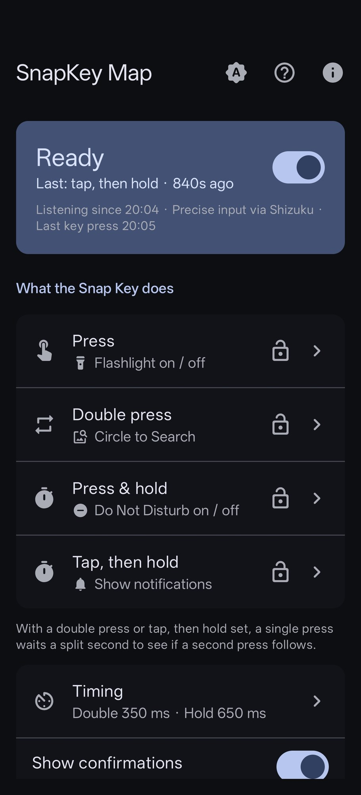
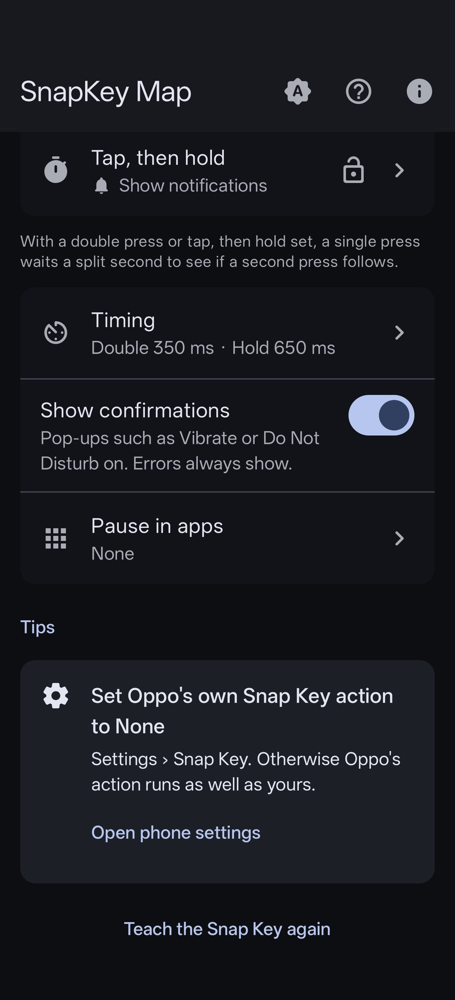
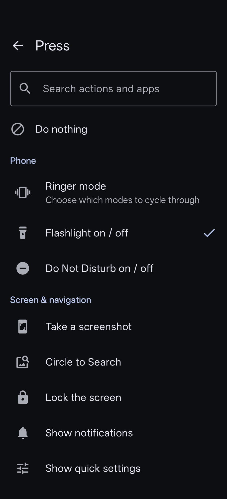
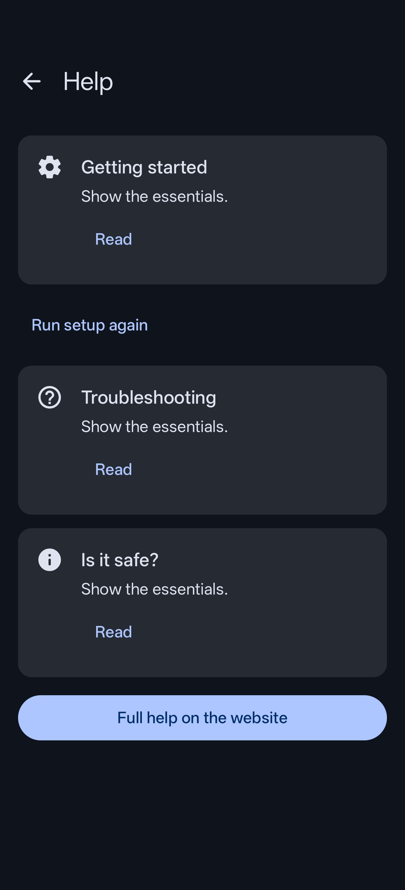
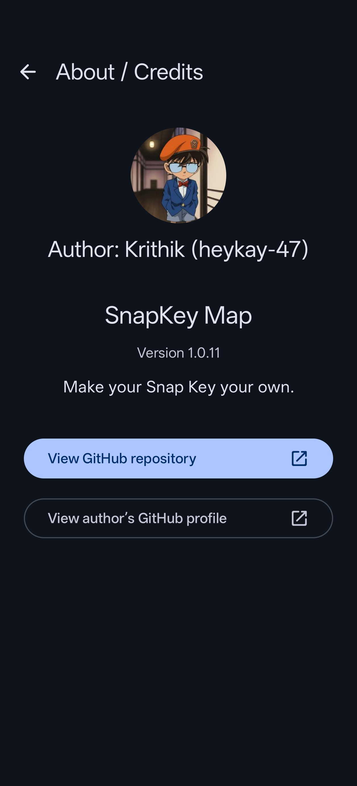
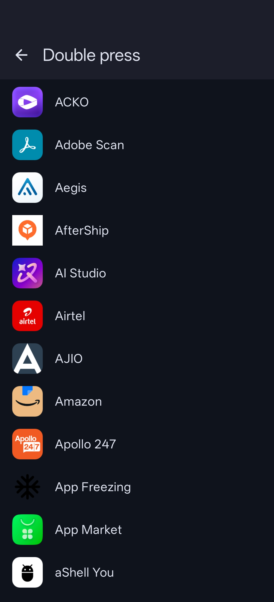

  

  

<h1 align="center">SnapKey Map</h1>

  Map your OPPO Snap Key or OnePlus Plus Key to any app or action. 
  A different action for a press, a double press, a press and hold, and a tap then hold. No root needed.

  
  
  
  
  
  
  

---

## Navigation

- [Screenshots](#screenshots)
- [Features](#features)
- [Supported phones](#supported-phones)
- [Requirements](#requirements)
- [Get started](#get-started)
- [Documentation](#documentation)
- [Roadmap](#roadmap)
- [Contributing](#contributing)
- [License](#license)
- [Support](#support)

# Screenshots

  
  
  

  
  
  

# Features

Assign one action each to **Press**, **Double press**, **Press & hold**, and **Tap, then hold**. For the last gesture, tap once, then hold the second press. When it is assigned, a quick double press runs on release instead of on the second press down.

Tap the lock next to a gesture to run it only when your phone is unlocked.

| Category | Actions |
| --- | --- |
| Phone | Flashlight, ringer presets you can create and edit (ring, vibrate, silent), a distinct vibration for each ringer mode, Do Not Disturb |
| Screen & navigation | Screenshot, Circle to Search, lock screen, notifications, quick settings, recent apps, home, back, power menu |
| Music & video | Play / pause, next and previous track, media volume up and down, mute / unmute media, volume slider |
| Open | Camera, video camera, voice assistant, Wi-Fi panel, Bluetooth settings, NFC panel, internet and mobile data panel |
| More | Call a contact (opens the dialer with their number), open a link (including `sms:` and `wa.me` links with a message filled in), run a supported app shortcut |
| Open an app | Any installed app |

On the home screen you can pause the key in chosen apps, such as the camera, and hide confirmation pop-ups. Errors still show.

Tap ▶ next to a gesture to try its action without pressing the key. Turn the mapping on or off from the **Snap Key** Quick Settings tile. Back up your settings, including the learned key, to a file and restore them after a reinstall. **Details** on the status card can copy a bug report or open a prefilled bug form.

The app follows Material 3 with dynamic colour and a System, Light, or Dark theme. It declares no internet permission.

# Supported phones

SnapKey Map supports **OPPO phones with a Snap Key** and **OnePlus phones with a Plus Key**. It is not limited to the Find X9. The app calls both buttons **Snap Key** during setup.

**App compatibility:** the maintainer tests on an **OPPO Find X9**. Users have also reported it working on the **Find X9 Pro, Find X9 Ultra, Find X9s, Find X9s Pro, OnePlus 15R, and OnePlus 13s**. Detection, screen-off behaviour, and background reliability can vary with the model and ColorOS / OxygenOS version. Teach the key during setup and test each gesture on your phone.

**Phones with the hardware:** examples found in product pages and reviews include:

- **OPPO:** Find X9, Find X9 Pro, Find X9 Ultra, Find X9s, Find X9s Pro; Find X10 and Find X10 Pro Max. Earlier Find X8s, Find X8s+, and Find X8 Ultra models also have a customisable shortcut button.
- **OnePlus:** OnePlus 15, OnePlus 15R, OnePlus 13s, OnePlus 13T, and OnePlus Nord 5.

This is not an exhaustive list or a claim that every listed model has been tested with SnapKey Map. Having the button alone does not guarantee detection on every firmware. Phones with only the older **Alert Slider**, or without a Snap / Plus Key, are not covered by this support claim. The separate camera **Quick Button** is not the Snap Key.

Sources for the phone hardware list (checked 11 November 2026)

- OPPO product pages: [Find X9](https://www.oppo.com/en/smartphones/series-find-x/find-x9/), [Find X9 Pro](https://www.oppo.com/en/smartphones/series-find-x/find-x9-pro/), [Find X9 Ultra](https://www.oppo.com/en/smartphones/series-find-x/find-x9-ultra/), and [Find X9s](https://www.oppo.com/en/smartphones/series-find-x/find-x9s/) describe the Snap Key. [ZOL's Find X9s Pro review](https://mobile.zol.com.cn/1169/11693710.html) describes its customisable physical shortcut key.
- Find X10 reviews: [Digital Trends — Find X10](https://www.digitaltrends.com/phones/the-oppo-find-x10-is-ridiculously-stacked-and-i-havent-even-got-to-the-cameras-yet/) and [The Hindu — Find X10 Pro Max](https://www.thehindu.com/sci-tech/technology/gadgets/oppo-find-x10-pro-max-review-one-of-this-seasons-best-android-flagships/article71656275.ece) describe the Snap Key on the left side.
- OPPO's Chinese product pages: [Find X8s](https://www.oppo.com/cn/smartphones/series-find-x/find-x8s/), [Find X8s+](https://www.oppo.com/cn/smartphones/series-find-x/find-x8s-plus/), and [Find X8 Ultra](https://www.oppo.com/cn/smartphones/series-find-x/find-x8-ultra/) describe a customisable physical shortcut key.
- OnePlus product pages: [OnePlus 15](https://www.oneplus.com/us/15), [OnePlus 15R](https://www.oneplus.com/global/15r), [OnePlus 13s](https://www.oneplus.in/13s), and [OnePlus Nord 5](https://www.oneplus.com/global/nord-5) describe the Plus Key. [The Verge's coverage of the 13s and 13T](https://www.theverge.com/news/674506/oneplus-13s-ai-plus-mind-key-button-india-availability) confirms the button on both models.

These sources establish the presence of the button, not app compatibility. Availability and naming vary by market.

# Requirements

- An OPPO phone with a Snap Key or a OnePlus phone with a Plus Key. See [supported phones](#supported-phones) for tested and user-reported models.
- Android 10 or later.
- One of these, for the one-time log permission:
  - [Shizuku](https://shizuku.rikka.app/guide/setup/), running through wireless debugging. No computer needed.
  - A USB cable and a computer with Google's [SDK Platform-Tools](https://developer.android.com/tools/releases/platform-tools).

# Get started

1. Download `SnapKeyMap-*.apk` from the [latest release](https://github.com/heykay-47/SnapKeyMap/releases/latest) on your phone and install it.
2. Set your phone's built-in Snap Key / Plus Key action to **None** or **No action** in Settings. Open SnapKey Map and follow the setup wizard. It gives the app log access through Shizuku or ADB, turns on the accessibility service, and teaches it your key.
3. Assign actions to the gestures and test each one. **Last:** in the Ready card shows what the app detected.

To update, install the new APK over the existing app. Do not uninstall first, or you lose your mappings and the log permission.

The [setup guide](docs/setup.md) explains each step, including the ADB command.

# Documentation

- [Setup guide](docs/setup.md). Installing and updating, the setup wizard, log access with Shizuku or ADB, and the accessibility permission.
- [Troubleshooting](docs/troubleshooting.md). Refused grants, the key stopping after a restart, and missed double presses.
- [Privacy and limits](docs/privacy.md). What the app reads, what it keeps, and what it cannot do.
- [Roadmap](ROADMAP.md). What comes next and what each release delivered.
- [Help and FAQ](https://heykay-47.github.io/SnapKeyMap/help.html) on the website.

# Roadmap

Next is the F-Droid release. The [roadmap](ROADMAP.md) lists every step and what each release delivered.

Have an idea? [Request a feature](https://github.com/heykay-47/SnapKeyMap/issues/new?template=feature_request.yml).

# Contributing

Bug reports, fixes, and device notes from OPPO and OnePlus phones on different ColorOS / OxygenOS versions are welcome. Read [CONTRIBUTING.md](CONTRIBUTING.md) for the code layout, Find X9 device notes, and how to build, sign, and release the app.

# License

SnapKey Map is free software under the [GNU General Public License v3.0 or later](LICENSE).

The third-party GSAP files in [`docs/vendor/gsap`](docs/vendor/gsap/README.md) retain their own license. They are used only by the website and are not part of the Android app.

# Support

SnapKey Map is free and has no ads. If it saves you a few taps, you can support its development.

  
  

# Thanks

- [SelenStudio/plus-key-remapper](https://github.com/SelenStudio/plus-key-remapper). Its OnePlus 15 Plus Key approach informed the system-log detection.
- [Shizuku](https://github.com/RikkaApps/Shizuku). Log access without a computer.
- [GSAP](https://gsap.com/). Animations on the website.

SnapKey Map is made by Krithik ([@heykay-47](https://github.com/heykay-47)). Tap the info button on the home screen for the About page.

# Stars <3

<a href="https://star-history.com/#heykay-47/SnapKeyMap&Date">
  <picture>
    <source media="(prefers-color-scheme: dark)" srcset="https://api.star-history.com/svg?repos=heykay-47/SnapKeyMap&type=Date&theme=dark" />
    <source media="(prefers-color-scheme: light)" srcset="https://api.star-history.com/svg?repos=heykay-47/SnapKeyMap&type=Date" />
    
  </picture>
</a>
