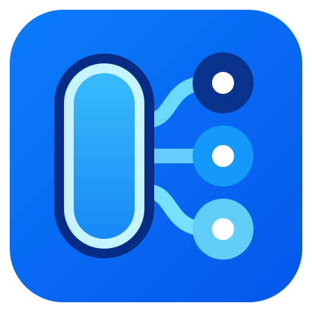
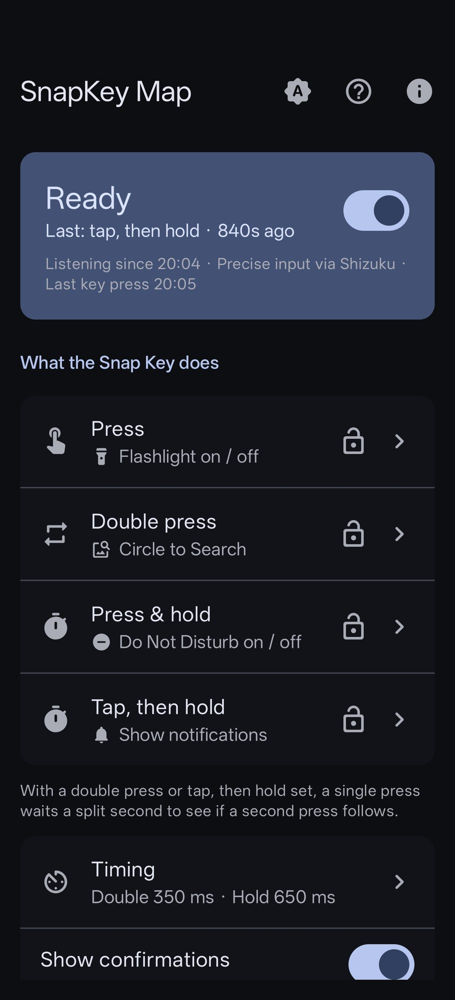
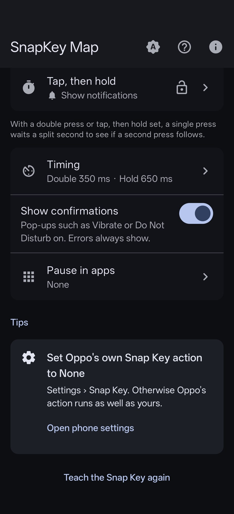
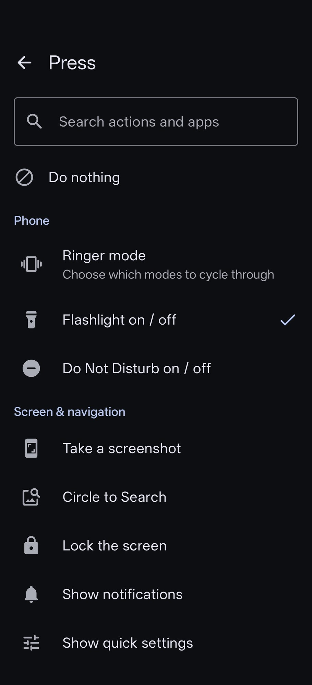
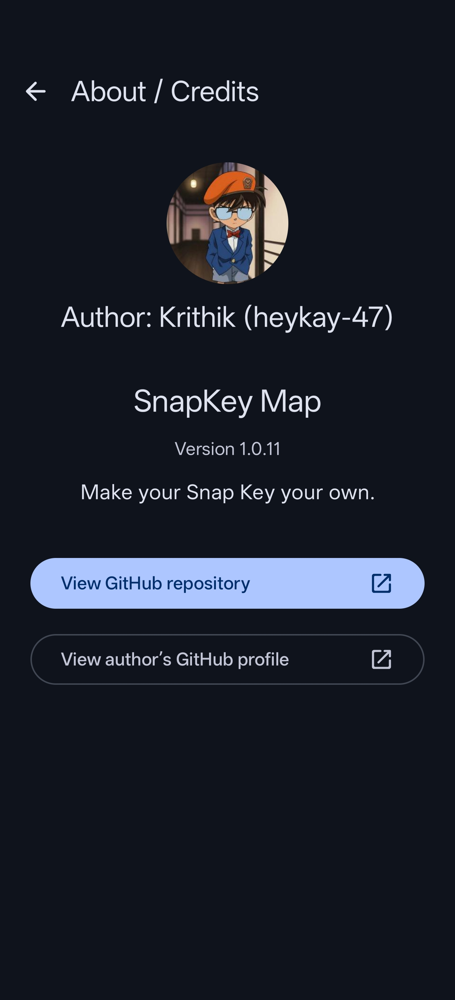
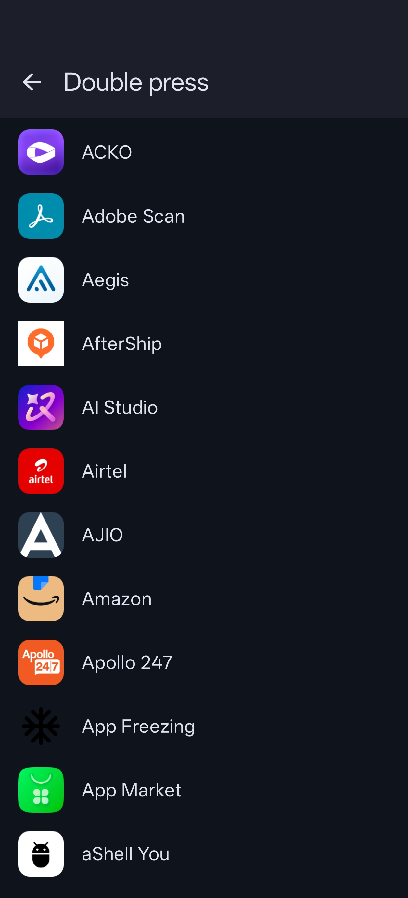
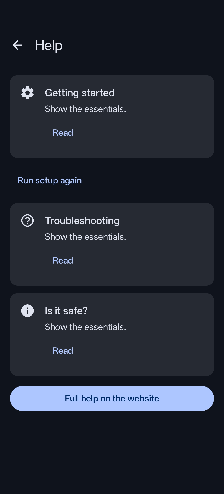

<p align="center">
  
</p>

<h1 align="center">SnapKey Map</h1>

<p align="center">
  Map the Oppo Find X9's Snap Key to any app or action.<br>
  A different action for a press, a double press, and a press and hold. No root needed.
</p>

<p align="center">
  <a href="https://github.com/heykay-47/SnapKeyMap/releases/latest"></a>
  <a href="https://github.com/heykay-47/SnapKeyMap/releases/latest"></a>
  <a href="https://github.com/heykay-47/SnapKeyMap/issues/new?template=bug_report.yml"></a>
  <a href="https://github.com/heykay-47/SnapKeyMap/issues/new?template=feature_request.yml"></a>
  <a href="https://heykay-47.github.io/SnapKeyMap/"></a>
  <a href="https://github.com/sponsors/heykay-47"></a>
  <a href="https://buymeatea.in/heykay47"></a>
</p>

---

## Navigation

- [Screenshots](#screenshots)
- [Features](#features)
- [Roadmap](#roadmap)
- [Requirements](#requirements)
- [Installation](#installation)
- [Setup wizard](#setup-wizard)
- [Log access (Shizuku & ADB)](#log-access-shizuku--adb)
- [Accessibility permission](#how-to-grant-the-accessibility-permission)
- [Troubleshooting](#troubleshooting)
- [Privacy and limits](#privacy-and-limits)
- [Contributing](#contributing)
- [License](#license)
- [Support](#support)
- [Full help and FAQ](https://heykay-47.github.io/SnapKeyMap/help.html)

# Screenshots

<p align="center">
  
  
  
</p>
<p align="center">
  
  
  
</p>
<p align="center">
  
</p>

# Features

Assign one action each to **Press**, **Double press**, and **Press & hold**.

| Category | Actions |
| --- | --- |
| Phone | Flashlight, ringer presets you can create and edit (ring, vibrate, silent), a distinct vibration for each ringer mode, Do Not Disturb |
| Screen & navigation | Screenshot, lock screen, notifications, quick settings, recent apps, home, back, power menu, split screen |
| Music & video | Play / pause, next and previous track, media volume up and down, mute / unmute media, volume slider |
| Open | Camera, video camera, voice assistant, Wi-Fi panel, Bluetooth settings, NFC panel, internet and mobile data panel |
| More | Call a contact (opens the dialer with their number), open a link (including `sms:` and `wa.me` links with a message filled in), run a supported app shortcut |
| Open an app | Any installed app |

On the home screen you can pause the key in chosen apps, such as the camera, and hide confirmation pop-ups. Errors still show.

The app follows Material 3 with dynamic colour and a System, Light, or Dark theme. It declares no internet permission.

# Roadmap

### Next: F-Droid

The F-Droid submission will request the same developer-signed APK as GitHub Releases. If accepted, you can switch between the two without uninstalling and keep the log permission.

- [x] **Free software license.** SnapKey Map is licensed under GPL-3.0-or-later.
- [x] **Store listing in the repository.** Title, descriptions, icon, and screenshots live in `fastlane/metadata`, where F-Droid reads them.
- [x] **Version codes set in the source.** F-Droid builds the same version code as GitHub, instead of one that depends on the CI run number.
- [ ] **Reproducible builds.** CI checks that an independent build from source matches the signed release byte for byte. F-Droid needs this before it can publish the developer-signed APK.
- [ ] **Release v1.0.15 with release notes.** The first release built for F-Droid.
- [ ] **Submit to F-Droid.** Open a merge request in [fdroiddata](https://gitlab.com/fdroid/fdroiddata) with the build recipe. Review can take days or weeks.

### Later: Google Play

- [ ] **Same signing key on Google Play.** Upload the existing key to Play App Signing before the first upload, so Play updates install over GitHub and F-Droid installs.
- [ ] **Accessibility disclosure.** Explain what the accessibility service does and ask for consent before the setup step, as Google Play requires for apps that are not accessibility tools.
- [ ] **Battery step through system settings.** Open Android's battery optimisation list instead of requesting the exemption directly, which Google Play restricts.
- [ ] **App bundle builds.** CI builds the Android App Bundle that Google Play requires.
- [ ] **Privacy policy and Data safety.** Publish a privacy policy on the website and declare that the app collects no data.
- [ ] **Closed test.** New personal developer accounts need 12 testers opted in for 14 days before a production release.

### From Reddit feedback (next release)

- [x] **Hide confirmation pop-ups.** Turn off Show confirmations to hide ringer and Do Not Disturb messages. Errors and permission reminders still show.
- [x] **Feel the ringer mode.** Ring uses one long buzz, Vibrate uses three short pulses, and Silent uses a tick.
- [x] **Pause in chosen apps.** Keep the key's normal behaviour in apps such as the camera.
- [x] **Settings and link tips.** Open phone Settings as a fresh task on ColorOS. The link dialog shows how to fill in a message with an `sms:` link.

### Delivered in v1.0.14

Delivered in v1.0.14 from feedback on the [launch post](https://www.reddit.com/r/Oppo/comments/1xaze1m/i_built_an_app_to_remap_the_oppo_find_x9s_snap_key/). The release was tested manually on a Find X9. Behaviour on other phones and firmware may differ.

- [x] **Oppo's native Silent mode with Shizuku.** Ringer presets use native Silent on Android 15 or later while Shizuku is running. Without Shizuku, Silent needs Do Not Disturb access and may turn on Do Not Disturb.
- [x] **Choose your ringer modes.** Create and edit presets with two or three modes in your chosen order. Editing a preset updates the gestures that use it.
- [x] **Grant Do Not Disturb access with Shizuku.** Request access from the app when your phone's Settings switch is unavailable.
- [x] **More precise key detection with Shizuku.** Teach the key again to use explicit press and release events instead of inferred log edges. Log detection remains the fallback.
- [x] **Adjustable timing.** Set the double-press window from 200 to 600 ms and the hold threshold from 300 to 1200 ms.
- [x] **Mute media toggle.** Mute and unmute media with one press.

Have an idea? [Request a feature](https://github.com/heykay-47/SnapKeyMap/issues/new?template=feature_request.yml).

# Requirements

- An Oppo Find X9. Other devices and ColorOS versions may behave differently. Users have also reported it working on the Find X9 Pro, X9 Ultra, X9s, X9s Pro, and OnePlus 15R.
- Android 10 or later.
- One of these, for the one-time log permission:
  - [Shizuku](https://shizuku.rikka.app/guide/setup/), running through wireless debugging. No computer needed.
  - A USB cable and a computer with Google's [SDK Platform-Tools](https://developer.android.com/tools/releases/platform-tools).

# Installation

1. Open the [latest release](https://github.com/heykay-47/SnapKeyMap/releases/latest) on your phone.
2. Download `SnapKeyMap-*.apk` and open it.
3. Allow your browser or file manager to install apps when Android asks.

You do not need a GitHub account to download the APK.

To update, install the new APK over the existing app. Do not uninstall first. An update signed with the same key keeps your mappings and the granted log permission.

With Shizuku running and allowed, run **Teach the Snap Key again** after updating to enable precise press and release detection. Your mappings stay unchanged. Without Shizuku, the app keeps using the system log.

> [!IMPORTANT]
> After updating from v1.0.3 or earlier, run **Teach the Snap Key again** once before you test your mappings. Older calibration can pick a log line that matches only key-down events and merges double presses. Your action assignments stay unchanged.

# Setup wizard

Open SnapKey Map. The wizard has seven steps. It saves your progress and resumes at the first unfinished step.

1. **Choose a method.** Shizuku works without a computer. Computer (ADB) uses a USB cable.
2. **Give log access.** Follow the [steps for your method](#log-access-shizuku--adb).
3. **Turn on accessibility.** See [below](#how-to-grant-the-accessibility-permission).
4. **Background operation (optional).** Allow the battery-optimisation exemption to reduce ColorOS interruptions, or tap **Skip**. Background reliability is not guaranteed.
5. **Notifications (optional).** Allow alerts for paused detection, or tap **Skip**. Actions run without notifications.
6. **Teach the key.** Set Oppo's own Snap Key action to **None** in phone Settings. Then follow the prompts: press three times and hold once.
7. **Choose actions.** Tap **Press**, **Double press**, or **Press & hold**. Assign at least one action, then tap **Finish**.

Test each gesture and check **Last:** in the Ready card. You can change actions on the home screen at any time. To repeat setup without clearing your mappings, choose **Run setup again** in Help.

# Log access (Shizuku & ADB)

ColorOS does not pass the Snap Key to apps. SnapKey Map detects it from the system log, so it needs the `READ_LOGS` permission once.

### Shizuku (no computer)

1. Install and start [Shizuku](https://shizuku.rikka.app/guide/setup/) with wireless debugging (Android 11+).
2. In the wizard's log-access step, tap **Grant with Shizuku** and allow the permission request. The button is enabled while Shizuku is running.

Keep Shizuku running. The app then reads logs through Shizuku and Android's device-logs prompt never appears. Shizuku may need starting again after a phone restart. If Shizuku stops, the app pauses until you allow Android's one-time device-log prompt or start Shizuku again. True Silent in ringer presets also needs Shizuku.

If ColorOS blocks the grant, see [ADB or Shizuku refuses to grant log access](#adb-or-shizuku-refuses-to-grant-log-access). You can also go back and choose Computer (ADB).

### ADB (with a computer)

1. Download Google's free [SDK Platform-Tools](https://developer.android.com/tools/releases/platform-tools) and unzip them.
2. On the phone, open **Settings → About device → Version**. Tap the build or version number seven times to enable Developer options.
3. In Developer options, turn on **USB debugging**.
4. Connect the phone with a USB cable and accept the USB debugging prompt.
5. Open a terminal in the unzipped `platform-tools` folder and run:

```shell
adb shell pm grant com.heykay.snapkeymap android.permission.READ_LOGS
```

In Windows PowerShell, use `.\adb` in place of `adb` if the command is not on your PATH. Success returns to the prompt without a message.

The ADB grant survives restarts and app updates. Without Shizuku, Android asks for one-time device-log access after each app or phone restart, and may ask again when the reader reconnects. The accessibility service tries to show that prompt for you. If ColorOS blocks it, reopen SnapKey Map and choose **Allow**.

# How to grant the accessibility permission

1. In the wizard, tap **Open accessibility settings**.
2. Find **SnapKey Map** and turn it on.
3. If Android blocks the switch, open **App info** for SnapKey Map, tap the three-dot menu, choose **Allow restricted settings**, and try again.

The service runs accessibility actions such as screenshot and lock, opens apps and the device-logs prompt from the background, receives supported key events, and helps keep the app running. It also sees which app is in front by package name only. The latest package name stays in memory and is used only to pause in the apps you choose. It cannot read screen content.

# Troubleshooting

### ADB or Shizuku refuses to grant log access

An error containing `Neither user 2000` and `GRANT_RUNTIME_PERMISSIONS` means ColorOS is blocking the shell from granting permissions.

1. Open Developer options on the phone.
2. Turn on **Disable permission monitoring**. Newer firmware may call it **Disable system optimization**.
3. If neither setting appears, switch the system language to English (United States) for a moment and reopen Developer options.
4. Read the warning before you accept. This setting relaxes manufacturer restrictions and may increase background power use.
5. Restart the phone. On ColorOS 16 the setting takes effect only after a restart. Then grant again.

If the setting is still missing, include your ColorOS version when you [report the problem](https://github.com/heykay-47/SnapKeyMap/issues/new?template=bug_report.yml).

### The key stops working after a restart

Open SnapKey Map and allow device-log access again. If the app shows **Paused**, tap **Connect**. You do not need to repeat the ADB grant unless you uninstalled the app or revoked the permission.

If you declined the log-access prompt, wait a minute before you try again. Check that the accessibility service is still on and that ColorOS allows background activity.

### A double press runs the single-press action

Set Oppo's own Snap Key action to None. Keep SnapKey Map open, double-press the key, and read the **Last:** text.

- `press` means the app did not recognise the double press. Update to v1.0.3 or later.
- `double press` means detection worked. Check the assigned action and that the selected app is still installed.

When you report a detection problem, include your app version, ColorOS version, assigned actions, and the text under **Last:**. Do not share an unfiltered system log. Device logs can contain sensitive information.

# Privacy and limits

SnapKey Map reads the system log on the phone to detect the Snap Key. The log permission covers more than key events. Lines are checked in memory and discarded, never saved or uploaded. Teaching keeps observations in memory and saves a learned log signature and, when available, an input key code. The app accepts a key log line only from the app that wrote it while you taught the key, which on the Find X9 is the system, so other apps can't fake a press.

With Shizuku allowed, the app runs `logcat` and also reads raw key input events using `getevent` as the shell user through Shizuku. Input events are filtered in memory, never stored or uploaded. A learned input key uses explicit press and release events while the input stream is live; otherwise detection falls back to the system log. Ringer actions also use Shizuku to switch modes with `cmd audio set-ringer-mode`, including true Silent on Android 15 or later. You can also use it to allow Do Not Disturb access. Other mapped actions do not use Shizuku. Apps and websites you open through an action have their own privacy policies.

The accessibility service sees the foreground app's package name only. It keeps only the latest name in memory and uses it only to pause in the apps you choose. It cannot read screen content. Your chosen paused-app package names are saved in settings.

Keep these limits in mind:

- A double-press assignment adds a wait after release before the single-press action runs: 350 ms by default, adjustable from 200 to 600 ms in **Timing**. The hold threshold defaults to 650 ms and can be set from 300 to 1200 ms.
- With a learned input key and a live Shizuku input stream, press and hold uses explicit key edges. Log fallback on the Find X9 infers press and release from known key lines. Other learned log formats need the line to repeat while the key is held.
- Screen-off detection and background reliability depend on ColorOS and are not guaranteed.
- The shortcut picker lists apps that provide `ACTION_CREATE_SHORTCUT`. It cannot list every pinned shortcut. A deep link may work instead.
- Calls are not placed directly, because the app has no calling permission. Call a contact opens the dialer, and direct-dial shortcuts show a message instead.
- With Shizuku running and allowed on Android 15 or later, ringer presets use true Silent without turning on Do Not Disturb. On older Android versions, without Shizuku, or if the shell command fails, Silent uses the public Android API, needs Do Not Disturb access, and may turn on Do Not Disturb. Without that access, the fallback skips Silent and shows a reminder. The Do Not Disturb toggle always needs notification policy access; the app asks when you assign it, or when assigning Silent without Shizuku.
- Mappings and the learned key are not included in Android backups.
- The app cannot bypass the lock screen or control every function in every app.

# Contributing

<a href="https://github.com/heykay-47/SnapKeyMap/graphs/contributors">
  
</a>

Bug reports, fixes, and device notes from other ColorOS versions are welcome. Read [CONTRIBUTING.md](CONTRIBUTING.md) for the code layout, Find X9 device notes, and how to build, sign, and release the app.

# License

SnapKey Map is free software under the [GNU General Public License v3.0 or later](LICENSE).

The third-party GSAP files in [`docs/vendor/gsap`](docs/vendor/gsap/README.md) retain their own license. They are used only by the website and are not part of the Android app.

# Support

SnapKey Map is free and has no ads. If it saves you a few taps, you can support its development.

<p align="center">
  <a href="https://github.com/sponsors/heykay-47"></a>
  <a href="https://buymeatea.in/heykay47"></a>
</p>

# Thanks

- [SelenStudio/plus-key-remapper](https://github.com/SelenStudio/plus-key-remapper). Its OnePlus 15 Plus Key approach informed the system-log detection.
- [Shizuku](https://github.com/RikkaApps/Shizuku). Log access without a computer.
- [GSAP](https://gsap.com/). Animations on the website.

SnapKey Map is made by Krithik ([@heykay-47](https://github.com/heykay-47)). Tap the info button on the home screen for the About page.

# Stars <3

<a href="https://star-history.com/#heykay-47/SnapKeyMap&Date">
  <picture>
    <source media="(prefers-color-scheme: dark)" srcset="https://api.star-history.com/svg?repos=heykay-47/SnapKeyMap&type=Date&theme=dark" />
    <source media="(prefers-color-scheme: light)" srcset="https://api.star-history.com/svg?repos=heykay-47/SnapKeyMap&type=Date" />
    
  </picture>
</a>
